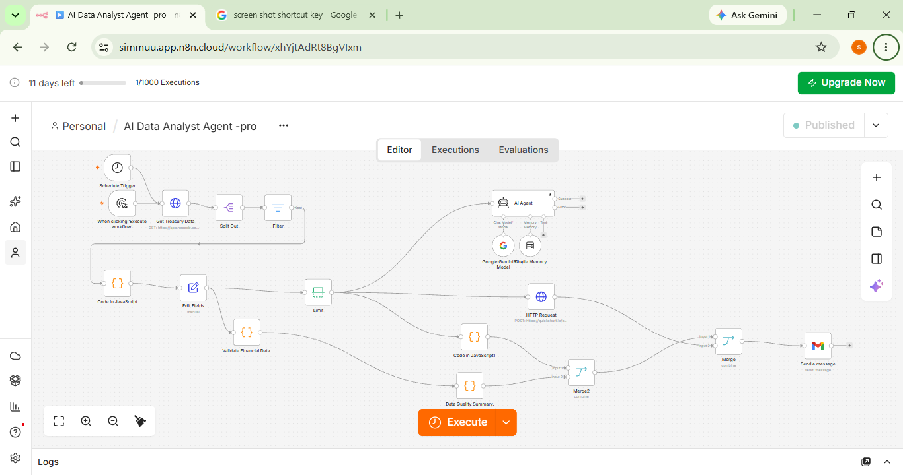
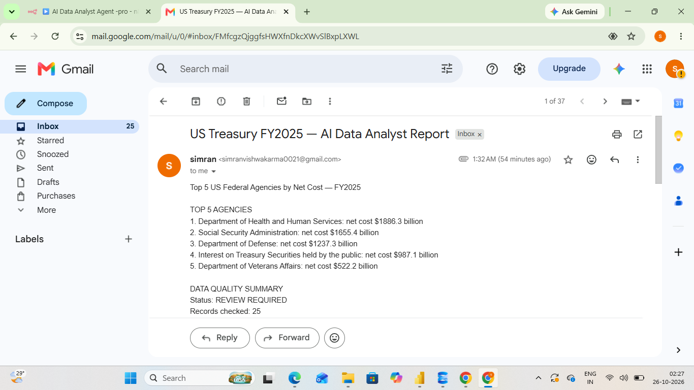
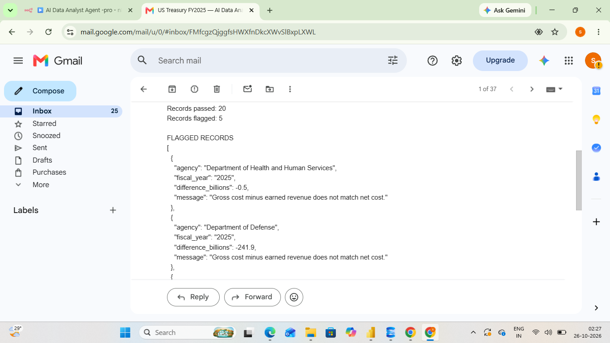
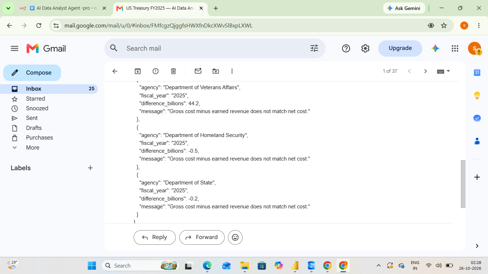
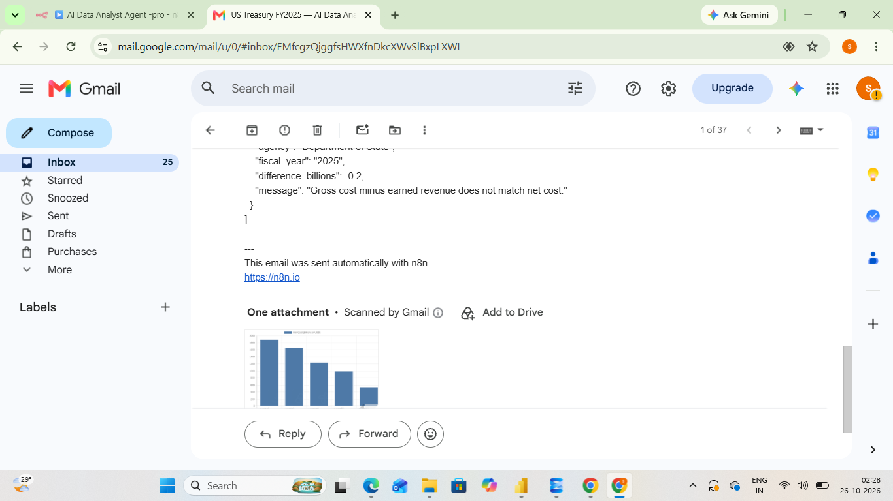
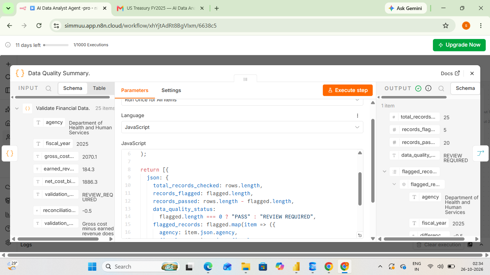

# US Treasury AI Data Analyst Agent

An automated financial reporting and data-quality monitoring solution built using **n8n, NocoDB, JavaScript, QuickChart, Gmail, and Google Gemini**.

<p align="center">
  <strong>Financial Analytics | Workflow Automation | Data Validation | Automated Reporting</strong>
</p>

---

## Project Overview

The **US Treasury AI Data Analyst Agent** automates the retrieval, transformation, analysis, validation, visualization, and reporting of federal agency net cost data.

The workflow retrieves FY2025 financial records from NocoDB, ranks agencies and reporting entries by net cost, validates financial calculations, identifies potential discrepancies, generates charts, and delivers consolidated reports through Gmail.

This project demonstrates how data analytics, JavaScript, and workflow automation can be combined to simplify recurring financial reporting and support data-quality monitoring.

## Business Problem

Financial reporting often involves repetitive data retrieval, calculations, ranking, validation, and report preparation.

Manual processes can consume time and make it harder to identify unusual values or potential inconsistencies.

This project addresses these challenges by automating key reporting and financial reconciliation activities.

## Business Objectives

- Automate recurring financial reporting.
- Identify the five highest-net-cost agencies or reporting entries.
- Validate relationships between gross cost, earned revenue, and net cost.
- Flag records that require further investigation.
- Generate charts for financial comparisons.
- Deliver consolidated reports through automated email.
- Reduce repetitive manual reporting activities.

## Technology Stack

| Technology | Purpose |
|---|---|
| n8n Cloud | Workflow automation and scheduling |
| NocoDB | Financial data retrieval |
| JavaScript | Data transformation, ranking, and validation |
| QuickChart | Chart generation |
| Gmail | Automated report delivery |
| Google Gemini | Optional AI analysis component |

## Workflow Architecture

The workflow follows an automated reporting pipeline:

1. **Trigger:** Starts manually or through a weekly schedule.
2. **Data Retrieval:** HTTP Request retrieves financial records from NocoDB.
3. **Record Expansion:** Split Out converts returned records into individual items.
4. **Fiscal-Year Filtering:** Selects records for FY2025.
5. **Field Mapping and Ranking:** JavaScript and Edit Fields prepare financial fields and rank records by net cost.
6. **Top Five Selection:** Limit retains the five highest-net-cost entries.
7. **Financial Validation:** JavaScript checks whether gross cost minus earned revenue reconciles with reported net cost.
8. **Quality Summary:** Counts records that pass validation and records requiring review.
9. **Chart Generation:** QuickChart generates a chart from the selected records.
10. **Report Delivery:** Merge nodes combine report and validation results before Gmail sends the email.

### Workflow Overview



## Automated Financial Report

The workflow generates an email report containing the top-five net-cost entries, financial summary, data-quality findings, and chart output.

### Sample Report Screenshots

**1. Sample Financial Report – Part 1**



**2. Sample Financial Report – Part 2**



**3. Sample Financial Report – Part 3**



**4. Sample Financial Report – Part 4**



## Data Quality & Financial Validation

The workflow performs a financial reconciliation check using the following relationship:

```text
Calculated Net Cost = Gross Cost - Earned Revenue
```

It calculates the reconciliation difference:

```text
Difference = Gross Cost - Earned Revenue - Net Cost
```

All amounts are expressed in billions of US dollars.

### Validation Rules

| Validation Status | Condition |
|---|---|
| OK | Absolute difference is less than or equal to 0.1 billion |
| REVIEW_REQUIRED | Absolute difference exceeds 0.1 billion |
| MISSING_OR_INVALID_DATA | Required financial values are missing or invalid |

The configured tolerance is **0.1 billion USD**.

### Data Quality Summary

The workflow generates the following metrics:

- Total records checked
- Records passed
- Records flagged
- Overall data-quality status
- Reconciliation differences
- Explanation for each flagged record

### Data Quality Results



## Example Results

The demonstrated FY2025 report ranked the following entries by net cost:

| Rank | Agency or Reporting Entry | Net Cost (USD Billions) |
|---:|---|---:|
| 1 | Department of Health and Human Services | 1,886.3 |
| 2 | Social Security Administration | 1,655.4 |
| 3 | Department of Defense | 1,237.3 |
| 4 | Interest on Treasury Securities held by the public | 987.1 |
| 5 | Department of Veterans Affairs | 522.2 |

### Demonstrated Data Quality Results

| Metric | Result |
|---|---:|
| Total Records Checked | 25 |
| Records Passed | 20 |
| Records Flagged | 5 |
| Overall Status | REVIEW REQUIRED |

These figures describe one demonstrated execution. Results may vary in future runs.

## Key Business Insights

The workflow supports analysis of:

- Federal agency net-cost rankings.
- Differences between calculated and reported net cost.
- Financial records requiring further investigation.
- Overall data-quality validation results.
- Financial comparisons through automated charts.

A flagged record is an investigation prompt, not proof that the source data is incorrect. Accounting definitions, rounding, and reporting conventions should be reviewed before drawing conclusions.

## Documentation

Additional project documentation:

- [System Architecture](./docs/architecture.md)
- [Data Quality Methodology](./docs/data-quality-methodology.md)

## Setup & Configuration

1. Set up an n8n instance or n8n Cloud account.
2. Import the sanitized workflow JSON.
3. Configure NocoDB credentials and the source table.
4. Configure Gmail and any required Google Gemini credentials.
5. Verify field mappings and fiscal-year filtering.
6. Confirm the financial validation formula and tolerance.
7. Configure QuickChart generation and email delivery.
8. Run a manual test and inspect the execution output.
9. Confirm that the email contains the report, validation summary, flagged records, and chart.
10. Enable scheduled execution after verifying the complete workflow.

After importing the workflow, replace placeholders and configure your own credentials.

## Security & Data Handling

- Never commit API tokens, passwords, OAuth secrets, or credential exports.
- Store credentials using n8n credentials or an appropriate secrets manager.
- Remove sensitive values from workflow JSON before publishing.
- Redact personal email addresses and private identifiers from screenshots.
- Do not publish private datasets unless redistribution is authorized.
- Review all files before committing them to a public repository.

## Skills Demonstrated

**Data Analytics**
- Financial data analysis
- Data validation and reconciliation
- Ranking and comparative analysis
- Data-quality monitoring

**Technical Skills**
- JavaScript
- n8n workflow automation
- NocoDB integration
- API integration
- QuickChart visualization
- Gmail automation

**Business Skills**
- Automated financial reporting
- Analytical problem-solving
- Exception identification
- Reporting process improvement

## Limitations & Future Improvements

- Improve resilience to AI model quota limits and temporary API failures.
- Add execution logging and failure notifications.
- Improve chart labeling and readability.
- Add automated tests for transformations and financial validation.
- Reconcile flagged records against authoritative source documentation.
- Verify scheduled executions and email delivery over multiple cycles.
- Document the authoritative dataset source, license, and refresh process.

## Project Status

The core reporting workflow has been demonstrated, including data retrieval, ranking, financial validation, chart generation, and email delivery.

Further verification is needed for scheduled execution reliability and AI component behavior.

## Disclaimer

This project is intended for analytical and portfolio purposes. Automated validation supports investigation and reconciliation; it does not replace official financial statements, accounting review, or authoritative Treasury guidance.

---

## Author

**Simran Vishwakarma**

Interested in Data Analytics, Business Intelligence, Financial Analytics, and Workflow Automation.

**GitHub:** [Simmii-19](https://github.com/Simmii-19)

